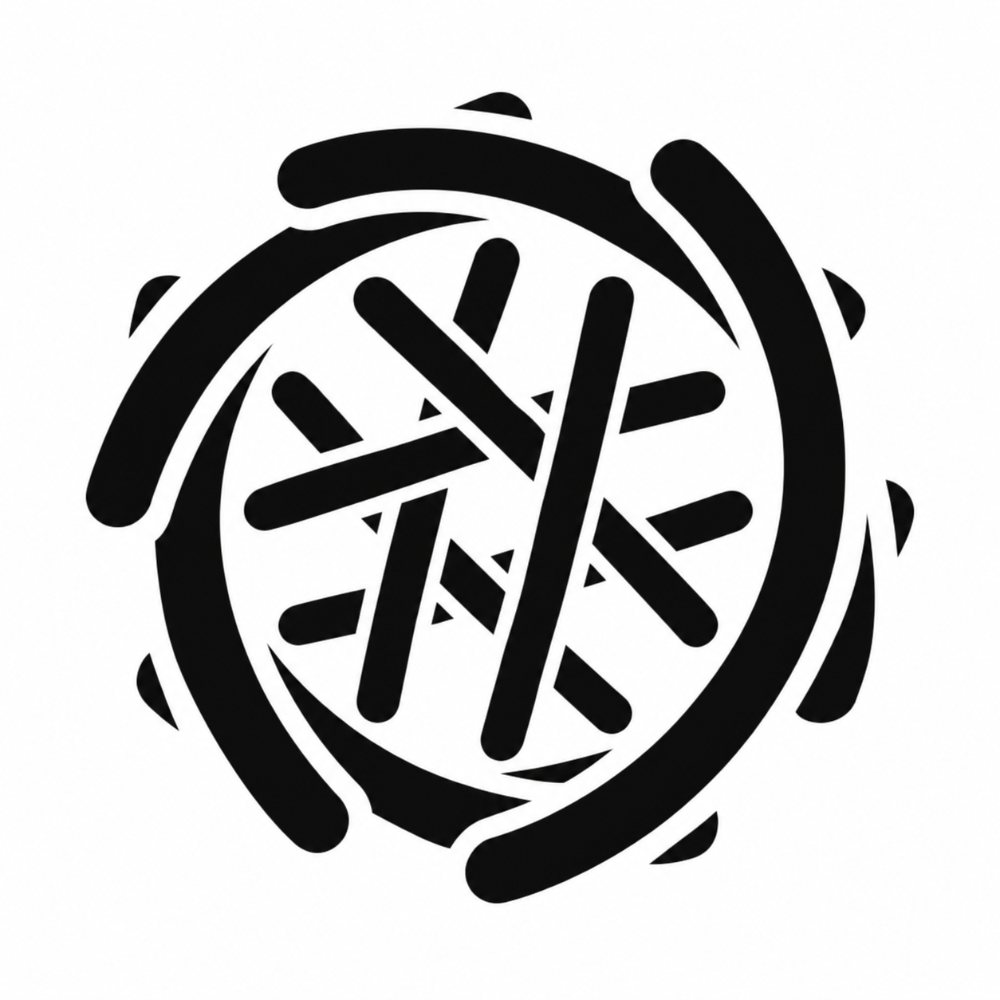
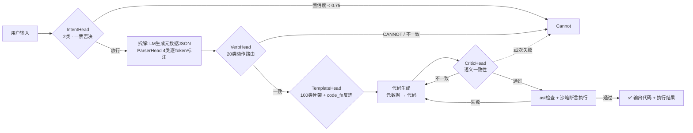
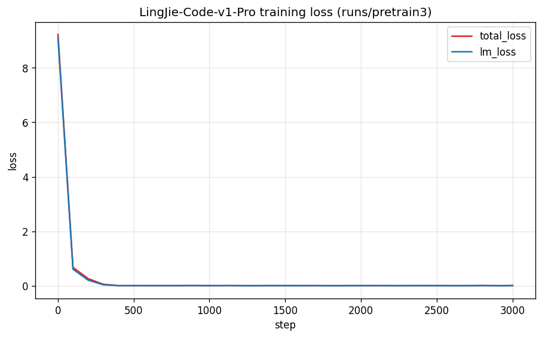
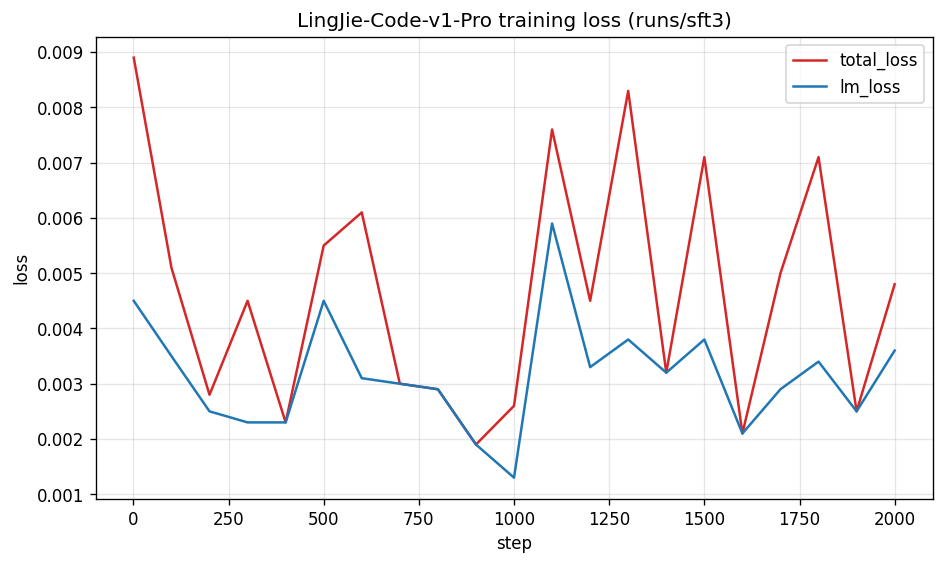
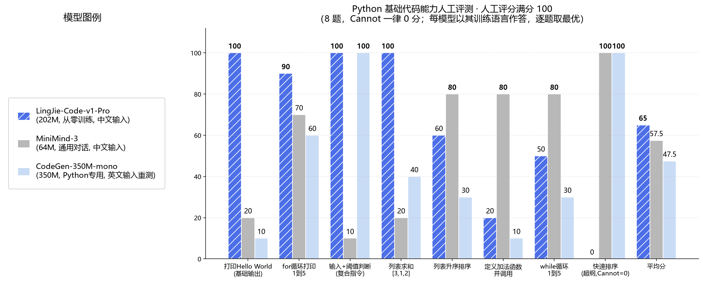

<div align="center">



# LingJie-Code-v1-Beta

**从零手写的 JAM 架构小型代码模型 —— 动作+数据 元数据翻译管道**

[-blue.svg)](#-许可证)
[]()
[]()
[]()
[]()

*零预训练权重 · 零 transformers 依赖 · 纯手写 PyTorch 架构 · 5-Head 级联决策链*

</div>

---

## 目录

- [项目理念](#-项目理念)
- [核心特性](#-核心特性)
- [架构设计](#-架构设计)
- [六层数据工程](#-六层数据工程)
- [训练策略与防爆手册](#-训练策略与防爆手册)
- [评测结果](#-评测结果)
- [快速开始（部署）](#-快速开始部署)
- [从零复现训练](#-从零复现训练)
- [沙箱与安全设计](#-沙箱与安全设计)
- [架构原创版权说明](#-架构原创版权说明)
- [许可证](#-许可证)
- [致谢](#-致谢)

---

## 💡 项目理念

LingJie-Code 的核心主张是：**小型模型不应该模仿大模型的"自由生成"，而应该走一条完全不同的路——把自然语言压缩成结构化元数据，再用确定性骨架翻译成代码。**

### 1. 动作 + 数据 元数据翻译管道

传统代码模型直接从 prompt 自回归生成代码，小模型在语法长程一致性上天然吃亏。LingJie-Code 把生成问题拆成了两个更简单的子问题：

```text
用户输入 ➡️ ① 意图判断 ➡️ ② 动作+数据拆解(JSON) ➡️ ③ 代码生成
        ➡️ ④ 轻量结构校验 ➡️ ⑤ ast 语法检查 ➡️ ⑥ 沙箱断言执行 ➡️ 输出 / Cannot
```

模型内部表示的不是代码文本，而是这样的元数据：

```json
{
  "action": "for",
  "range": "1, 5",
  "data": ["i"],
  "body": ["print(i)"]
}
```

每个字段都是有限集合中的一个取值（100 个骨架、20 个动作、规则化的槽位），小模型要学的不再是"无限的代码空间"，而是"有限的翻译表"。**这是小型模型在垂直领域逼近确定性输出的关键设计。**

### 2. 拒绝（Cannot）是核心能力，不是失败兜底

模型能力边界被显式建模：5 个辅助 Head 中有 2 个拥有一票否决权，IntentHead 置信度不足直接拒绝，动作路由到 `CANNOT` 类同样拒绝。**在能力边界之外，宁可说"不"，也绝不输出看似合理实则错误的代码**——这使模型在部署中具有可预测的行为边界。

### 3. 每个模块都要"干活"，绝不吃白饭

5 个辅助 Head 不是训练时的统计摆设，而是在推理管线中以**硬编码决策逻辑**串行级联：Intent 一票否决 → Parser 逐 Token 标注 → Verb 动作路由（20 类）→ Template 骨架选择（100 类，并用骨架的确定性代码函数反选消歧）→ Critic 语义一致性 + 触发修复循环。任何一个环节不过关，要么走修复循环，要么 Cannot。

### 4. 100% 从零训练

模型权重从 `torch.nn.init` 随机初始化开始训练。**不加载任何开源预训练权重（无 LLaMA/Qwen/GPT/Pythia），不使用 `transformers.AutoModel`，不使用 `nn.TransformerEncoderLayer`**——整个 Transformer 前向（注意力、RoPE、卷积、FFN、缓存）全部由本项目手写实现。

---

## ✨ 核心特性

| 特性 | 说明 |
|---|---|
| 🏗️ JAM 架构 | Attention + Depthwise-Causal-Conv + SwiGLU 三通路融合块（原创设计） |
| 🧠 GQA 分组查询 | 8 个 Q 头 / 2 个 KV 头，极小模型下显著压缩 KV Cache |
| 🌊 因果深度卷积 | kernel=5 严格因果（仅左补零），捕获局部 token 模式（缩进、字面量） |
| 🚀 JAM-DualState Cache | 原创"联合双状态缓存"：KV Cache + CNN 归一化状态滑窗，训练-推理逐元素一致（最大误差 2.6e-6） |
| 🎯 5-Head 级联决策链 | Intent / Parser / Verb / Template / Critic，全部参数化 num_classes，可插拔到 Sentence 模型 |
| 🛡️ 沙箱断言执行 | ast 语法检查 + 静态危险调用护栏 + 隔离子进程执行 + stdout 逐行对拍 |
| 🔧 修复循环 | Critic 拒绝或沙箱报错自动触发重生成，最多 2 次，仍失败输出 Cannot |
| 🈶 中文原生 | 中文指令理解 + 脏变量名自动规范化（张三→zhang_san、var-1→var_1），数字单字切分 |

---

## 🏗️ 架构设计

### JAM Block（Joint Attention-Conv Module）

每个 JAM Block 包含三条通路，全部使用 Pre-norm RMSNorm + 残差连接 + LayerScale：

```text
① 全局通路（Attention）:
   x = x + γ_attn · RoPE_Causal_GQA_Attention(RMSNorm(x))

② 局部通路（CNN）:
   x = x + γ_conv · Depthwise_Causal_Conv1d(RMSNorm(x))

③ 门控通路（FFN）:
   x = x + γ_ffn  · SwiGLU_FFN(RMSNorm(x))
```

| 配置项 | 值 | 说明 |
|---|---|---|
| d_model | 640 | 隐藏维度 |
| 层数 | 52 | 深窄结构，总参数 202.1M |
| Q 头 / KV 头 | 8 / 2 | GQA，head_dim=80 |
| 卷积核 | 5 | 深度可分离、严格因果（左侧补零 4） |
| d_ff | 640 × 2.13 = 1363 | SwiGLU 三矩阵 |
| LayerScale γ | **1e-4**（严格初始值） | 防止深层堆叠 + 多任务联合训练的梯度爆炸 |
| 词表 | 8192 | 自研分词器：数字单字切分（1234→1,2,3,4）、缩进空格逐个保留 |

三条通路的分工直觉：**Attention 负责"读题"**（跨 token 的意图聚合），**因果卷积负责"仿写"**（缩进、`print(`、引号包裹等代码局部 n-gram 模式，卷积天然擅长），**SwiGLU 负责"知识"**（动作到语法的映射存储）。

### JAM-DualState Cache（原创联合双状态缓存）

标准 KV Cache 无法直接用于带深度因果卷积的架构。JAM Block 的每个层维护两个独立状态容器：

- `attn_kv_cache`：标准 KV Cache，增量拼接，形状 `[batch, n_kv_heads, seq_len, head_dim]`
- `cnn_norm_history`：CNN 滑动窗口，形状 `[batch, d_model, kernel_size-1]`

**关键设计**：CNN 层缓存的是 **RMSNorm 之后的隐状态**——RMSNorm 是 token-wise 的，历史 token 的归一化结果一旦算出便固定不变，不受后续 token 影响，因此缓存它即可无损增量推理。增量流程：

```text
conv_input = concat(cnn_norm_history, x_norm_now)   # [b, d, k]
out = Σⱼ wⱼ · conv_inputⱼ + bias
cnn_norm_history ← FIFO 更新（弹最旧，压最新）
```

卷积的全序列路径与增量路径采用**完全相同的逐 tap 累加实现**，保证训练-推理逐元素一致（实测 lm_logits 最大误差 2.6e-6，为 fp32 浮点噪声级别）。

### 5-Head 级联决策链



Head 的 `num_classes` 全部参数化（`model/heads.py`），JAM 底座可与未来的 Sentence 模型共享——推理管线的"翻译层"可插拔：**Code 走沙箱断言，Sentence 走合理性判断**。

### 模板反选消歧

元数据签名相同的骨架（如 `print(字符串)` 与 `print(字符串.upper())`）会让 TemplateHead 产生歧义。管线采用"生成后反选"策略：先由元数据生成代码，再在 Top-5 候选骨架中用每个骨架的确定性 `code_fn(meta)` 与生成代码精确匹配，反选出唯一模板 ID，并使用该模板的沙箱真值（预期 stdout / stdin / 文件预置）做断言。

---

## 📊 六层数据工程

训练数据 100% 程序化合成 + 网络教程语料做措辞种子，共 **525,000 条**，六层级联：

| 层 | 数据类型 | 条数 | 作用 |
|---|---|---|---|
| L1 | 意图边界（正样本 / 非代码 / 灰色超纲） | 55,000 | 训练 IntentHead 一票否决 |
| L2 | 动作-数据拆解 + 逐 Token 角色标注 | 100,000 | 训练 ParserHead + 元数据生成 |
| L3 | 动作细分类（20 类） | 79,986 | 训练 VerbHead 动作路由 |
| L4 | 模板匹配（元数据 → 100 模板 ID） | 65,000 | 训练 TemplateHead 骨架选择 |
| L5 | 代码生成（元数据 JSON → 代码 + stdout 真值） | 170,000 | 训练生成 |
| L6 | 一致性验证（含"语法对但语义错"负样本） | 55,000 | 训练 CriticHead |

数据质量增强：

- **暴力穷举泛化**：print/if/for 三动作 ≥ 100,000 条自然语言变体（"打印Hello" / "输出Hello" / "把Hello显示出来"映射到同一元数据），让模型背熟措辞分布而非依赖硬规则拦截
- **脏数据注入（20%）**：强制混入中文/非法变量名样本（张三、var-1、我的变量），训练模型自动规范化为 zhang_san、var_1、my_var
- **中文数字**："十八" → 18 归一化
- **100 个代码骨架共享真值**：数据生成与推理沙箱共用同一套 `synth_core.py` 模板注册表，每个骨架带确定性 `code_fn`（生成代码）、`out_fn`（预期 stdout）、`inputs_fn`（stdin）、`setup`（文件预置），800 次沙箱实例化自检 100% 通过

---

## 🔥 训练策略与防爆手册

小模型多任务联合训练极易 Loss 爆炸，本项目固化了一套经过验证的防爆策略：

1. **BF16 混合精度**（`torch.amp.autocast`），L40S 48G 单卡实测 13,114 tok/s（micro_batch 64 × 梯度累积 4 = 全局 batch 256）
2. **梯度裁剪（必加）**：`clip_grad_norm_(max_norm=1.0)`，全程 gnorm 0.01~1.1，无爆炸
3. **Loss 权重缩放**：`total = lm + 0.1·intent + 0.1·parser + 0.05·critic + 0.05·template + 0.1·verb`，辅助 Head 权重绝不过大
4. **Padding Mask 对齐**：所有辅助 Head 的 CE 一律 `ignore_index=-100`，且全空标签批次显式返回 0（避免 NaN 污染梯度）
5. **学习率**：预训练 3e-4（cosine + warmup 300 步）→ SFT 1e-5
6. **LayerScale γ=1e-4**：深层堆叠（52 层）下残差通路初始近乎恒等映射，训练 100 步内 LM Loss 即从 9.2 降到 0.74

**训练曲线（预训练，3076 步 / 55 分钟）：**



**SFT 曲线（2051 步 / 38 分钟）：**



---

## 📈 评测结果

### 自动化验收（留出集，独立种子生成，零训练重叠）

| 指标 | 结果 |
|---|---|
| IntentHead 准确率 / **Cannot 拦截率** / 误拦率 | **100% / 100% / 0%**（n=2000） |
| ParserHead 逐 Token 准确率 | 97.3%（n=9044） |
| VerbHead 20 类动作路由准确率 | 98.5%（n=1050） |
| TemplateHead 100 类骨架 top-1 | 81.6%（管线 code_fn 反选兜底） |
| CriticHead 语义一致性准确率 | 89.5%（n=600） |
| **端到端沙箱断言通过率** | **97.5%**（n=200） |
| JAM-DualState Cache 训练-推理一致性 | PASS（最大误差 2.6e-6） |
| 增量解码速度 | ~164 tok/s（batch=1，52 层内核启动瓶颈） |

### 三方人工评测（非程序判题，逐题人工打分）

评分口径：意图理解 3 + 代码正确可运行 3 + 指令细节 2 + 规范/得体 2（满分 10/题）；**Cannot 一律 0 分，代码正确才算胜出**。



| 排名 | 模型 | 参数量 | 平均分 |
|---|---|---|---|
| 🥇 | **LingJie-Code-v1-Beta（本项目）** | 202M | **65.0** |
| 🥈 | MiniMind-3（通用对话） | 64M | 57.5 |
| 🥉 | CodeGen-350M-mono（Python 专用） | 350M | 22.5 |

**结论**：领域内（打印 / 循环 / 输入+判断 / 求和）4 题满分且输出经沙箱确定性验证；通用代码题（排序方向 / def 加法 / while）暴露骨架边界外的脆性——这正是"窄域确定性"路线的诚实代价。MiniMind 对话小模型则呈现"基础题复读失控、高频样板代码反而惊艳"的记忆检索特征。

---

## 🚀 快速开始（部署）

### 环境要求

- Python ≥ 3.10，PyTorch ≥ 2.4（CUDA）
- 单卡显存 ≥ 4GB 即可推理（bf16/fp32）
- 推理零第三方依赖：仅 PyTorch + 标准库

### 1. 下载代码与权重

```bash
git clone https://github.com/9178nekomc/LingJie-Code-v1-Beta.git
cd LingJie-Code-v1-Beta
```

从 [Releases](https://github.com/9178nekomc/LingJie-Code-v1-Beta/releases) 下载 `ckpt_final.pt`（801MB，含模型配置），放置到 `runs/sft3/ckpt_final.pt`：

```bash
mkdir -p runs/sft3
wget -O runs/sft3/ckpt_final.pt https://github.com/9178nekomc/LingJie-Code-v1-Beta/releases/download/v0.1.0-beta/ckpt_final.pt
```

### 2. 交互推理

```bash
python inference/pipeline.py --ckpt runs/sft3/ckpt_final.pt "打印Hello World"
python inference/pipeline.py --ckpt runs/sft3/ckpt_final.pt "获取用户输入，如果小于18就输出no，否则输出yes"
python inference/pipeline.py --ckpt runs/sft3/ckpt_final.pt "帮我写个爬虫"   # -> Cannot
```

输出示例：

```text
Q: 获取用户输入，如果小于18就输出no，否则输出yes
status: ok
x = int(input())
if x < 18:
    print("no")
else:
    print("yes")
stdout: 'no\n'          # stdin=10 时的沙箱实测输出
```

### 3. Python API

```python
from inference.pipeline import LingJiePipeline

pipe = LingJiePipeline("runs/sft3/ckpt_final.pt", seed=1)
result = pipe.run("用for循环从1到5，每次打印i")
print(result["status"])   # "ok" 或 "Cannot"
print(result["code"])     # 生成的 Python 代码
print(result["stdout"])   # 沙箱实测输出
print(result["trace"])    # 完整决策链：intent/parse/verb/template/critic/sandbox
```

---

## 🧪 从零复现训练

全链路一条命令（单卡 L40S 实测约 1.7 小时）：

```bash
bash run_all.sh
```

分步执行：

```bash
# 1. 拉取网络教程语料（措辞种子）
python data_pipeline/fetch_web.py

# 2. 合成六层数据集（52.5 万条）
python data_pipeline/gen_data.py

# 3. 训练分词器 + 预分词打包（首次运行后必须复用已生成的 tokenizer.json）
python build_dataset.py

# 4. 预训练（BF16, lr 3e-4, 全局 batch 256）
python training/pretrain.py --micro-bs 64 --accum 4 --epochs 1.5

# 5. SFT 精调（lr 1e-5）
python training/sft_train.py --ckpt runs/pretrain/ckpt_final.pt

# 6. 验收评测（自动生成独立留出集）
python eval/make_eval_set.py
python eval/report.py runs/sft/ckpt_final.pt
```

一致性自检：

```bash
python tests/test_forward.py      # 随机张量前向 + LayerScale 初始化断言
python tests/verify_cache.py      # JAM-DualState Cache 训练-推理逐元素一致性
python tests/test_templates.py    # 100 骨架沙箱真值自检（800 次实例化）
```

> ⚠️ **重要**：`build_dataset.py` 检测到已有 `tokenizer/tokenizer.json` 时会复用而不重训——词表 ID 与 checkpoint 的 embedding 行一一绑定，重训分词器会使所有旧权重作废。

---

## 🛡️ 沙箱与安全设计

代码执行前经过四道关卡：

1. **ast.parse** 语法检查
2. **静态护栏**：拦截 `__import__` / `exec` / `subprocess` / `socket` 等危险构造
3. **隔离子进程**：`python -I -c`（isolated mode，忽略环境变量与用户 site-packages），stdin 注入、超时 10s 强杀
4. **stdout 断言**：与模板注册表的确定性真值逐行 strip 对拍

任何一关失败即触发修复循环（≤2 次），修复失败输出 Cannot——**模型永远不会把未经验证的代码直接交给用户**。

---

## ©️ 架构原创版权说明

**JAM 架构（Joint Attention-Conv Module）及 JAM-DualState Cache 为本项目原创设计。**

1. **实现独立性**：本项目全部神经网络组件——RMSNorm、RoPE 旋转位置编码、GQA 因果注意力、深度可分离因果卷积、SwiGLU FFN、LayerScale、双状态缓存、自回归解码器——均为纯 PyTorch 手写实现，未使用 `transformers`、`nn.TransformerEncoderLayer`、FlashAttention 或任何第三方模型库；未加载、未蒸馏、未微调任何开源预训练权重。

2. **设计独立性**：三通路 JAM Block（注意力全局通路 + 因果卷积局部通路 + SwiGLU 门控通路，Pre-norm RMSNorm + LayerScale 串接）与"CNN 归一化状态滑窗 + 标准 KV Cache"的联合双状态缓存方案为本项目首次提出并实现，非对现有论文或开源项目的复现或改写。

3. **许可约束**：基于本作品及其衍生作品必须以 **LingJie 公共许可证 1.0**（GPL-3.0 强传染 + Apache-2.0 专利条款 + AGPL 式服务闭合的合成单一许可证，见 [LICENSE](LICENSE)）开源；任何对 JAM 架构的修改、移植、二次训练模型（含权重再分发）均受其约束。

4. **引用**：若研究或产品使用了本项目的架构、缓存方案或评测方法，请标注：

```bibtex
@software{lingjie_code_2026,
  title  = {LingJie-Code-v1-Beta: A From-Scratch JAM-Architecture Code Model
            with Metadata Translation Pipeline},
  author = {LingJie Project},
  year   = {2026},
  url    = {https://github.com/9178nekomc/LingJie-Code-v1-Beta}
}
```

---

## 📜 许可证

本作品采用自定义的单一许可证——**LingJie 公共许可证 1.0**（[LICENSE](LICENSE)），
将 GPL-3.0 与 Apache-2.0 的核心条款合而为一，用户无需做任何选择，全部条款同时适用：

| 继承来源 | 并入条款 | 效果 |
|---|---|---|
| GPL-3.0（第 2-7 条实质内容） | 强传染 Copyleft | 任何衍生作品——包括以本权重二次训练/微调/蒸馏产生的新模型及其推理代码——必须整体以本许可证开源，并完整提供训练代码、数据生成代码与推理代码 |
| GPL-3.0（第 15/16 条） | 免责声明 | 无担保、责任限制 |
| Apache-2.0（第 3 条） | **专利授予** | 每位贡献者授予用户永久、免费、全球性的专利许可 |
| Apache-2.0（第 9.3 条） | **专利报复** | 任何人对本项目提起专利主张，其专利许可立即终止且不可恢复 |
| AGPL 精神（新增第四章） | 网络服务闭合 | 以云端 API 形式提供推理能力同样必须开放对应源码，防止"只做服务不开源"的规避 |
| 新增 | 权重再分发义务 | 模型权重再分发必须附带本许可证与全部源码组件 |

一句话：**代码传染性（GPL）+ 专利安全性（Apache）+ 服务端闭合（AGPL）三重保障，单一文本，无选择成本。**

> 参考基准：本许可证以 GPL-3.0 与 Apache-2.0 的公开文本为解释参考（见仓库根目录
> `LICENSE-GPL-3.0` 与 `LICENSE-APACHE-2.0` 原文存档），冲突时以本许可证为准。

---

## 🙏 致谢

- [MiniMind](https://github.com/jingyaogong/minimind)（jingyaogong/minimind-3, 64M）与 [Salesforce CodeGen-350M-mono](https://github.com/salesforce/CodeGen)：本次人工对比评测的基线模型，其权重通过 HuggingFace 镜像获取，仅用于评测对照；
- [Python 官方文档（中文）](https://docs.python.org/zh-cn/3/tutorial/)：作为合成数据的措辞种子语料之一；
- 所有从零训练社区的精神股东们——30元GPU费用 和 8 小时显卡时间，也能换来一个诚实、可控、会拒绝的小模型。

---

<div align="center">

**LingJie-Code-v1-Beta** · Built from scratch with ❤️ and one L40S

*打印、循环、判断、求和——小模型也能把简单的事情做到确定性正确。*

</div>
